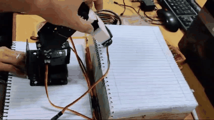
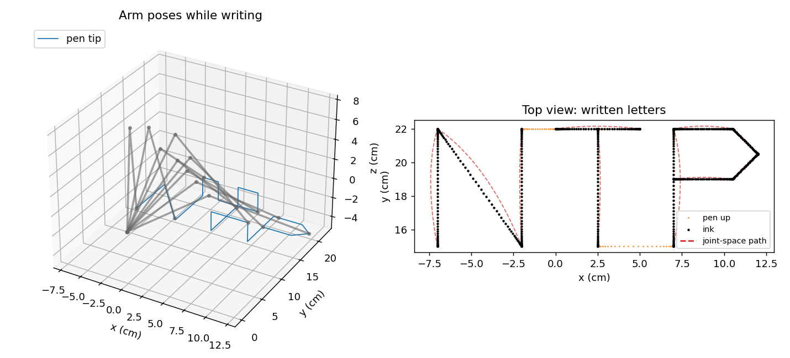

# 6-DOF Robot Arm: Kinematics, Trajectory Planning and Handwriting

A desktop 6-DOF arm (MG996R servos, Arduino) that writes letters with a pen.
This repo has the Python kinematics and trajectory planner, the Arduino firmware
that ran on the real robot, and a simulator that reproduces it.



*Team project for Robot Mechanics & Control, MS Robotics & Intelligent Machine
Engineering, NUST (2024). My part was the kinematics, the trajectory code and the
servo firmware.*

## What it does

- **Forward kinematics** of the full 6-joint chain from DH parameters measured
  on the arm, including servo calibration offsets and a reversed joint.
- **Closed-form inverse kinematics** for the pen tip (base yaw, shoulder, elbow).
  It reproduces the servo angles used on the robot to 0.01°.
- **Quintic trajectories** with zero velocity and acceleration at each waypoint,
  so the servos start and stop smoothly.
- **Straight strokes:** the planner moves the pen in Cartesian space and solves IK at
  every sample. Interpolating joint angles directly bows the strokes. In
  simulation that bow reaches **0.62 cm** on a 7 cm stroke. The Cartesian planner
  keeps it at zero.
- **Workspace guards:** no motion below the table or into the column around the base.



## Run it

```bash
pip install -r requirements.txt
python demos/write_letters.py        # prints the deviation table, saves media/letters_sim.png
python -m pytest -q                  # 10 tests: IK/FK round trip, quintic boundary conditions, ...
```

## Layout

```
arm/kinematics.py     DH forward kinematics, closed-form pen IK, workspace checks
arm/trajectory.py     quintic coefficients, joint-space vs Cartesian segments
demos/                letter-writing simulation
tests/                pytest suite
firmware/             Arduino sketches that ran on the robot (letters N/P/T,
                      quintic spline, pick-and-drop, FK/IK)
legacy/               the original course scripts, kept for reference
media/                demo GIF and plots
```

## Notes

- Lengths are in cm and angles in degrees. Pen model: upper arm 10.4 cm,
  forearm + pen 15 cm. A few sketches declare 12 cm, but the angles sent to the
  servos were computed with 15 cm. At 12 cm the top of the letters is out of
  reach, and the simulator flags this.
- The first firmware version interpolated joint angles linearly. The later
  `quintic_spline` sketch added smooth timing. The Python planner goes one step
  further with straight-line strokes.

**Keywords:** robotics, forward kinematics, inverse kinematics, Denavit-Hartenberg,
trajectory planning, quintic polynomial, Arduino, servo control, Python, NumPy.
